# Libaas Kiraya — Application Flow

| Field | Value |
|---|---|
| Document version | 1.0 (Draft for build) |
| Date | 21 October 2026 |
| Author | Saleh |
| Related docs | `PRD.md` (rules), `TRD.md` (workflows, APIs), `Backend-Schema.md` (states), `UI-UX-Design.md` (screens) |

Diagrams use Mermaid and render on GitHub and most Markdown viewers. Status names match `Backend-Schema.md` §8.

---

## 1. Actors and surfaces

| Actor | Surface | Auth actor type |
|---|---|---|
| Customer (renter) | Storefront | `customer` |
| Vendor owner / staff | Vendor portal (`/vendor`) | `vendor` |
| Admin | Medusa Admin | `user` |
| System | Scheduled jobs, subscribers, webhooks | n/a |

## 2. System overview

```mermaid
flowchart LR
    A[Customer searches by date and city] --> B[Listing detail and calendar]
    B --> C[Reserve: 15-minute hold]
    C --> D[Checkout and payment]
    D --> E[Booking confirmed]
    E --> F[Handover or delivery]
    F --> G[Customer wears the outfit]
    G --> H[Return]
    H --> I[Vendor inspection]
    I --> J{Customer decision}
    J -->|Accept or silence| K[Deposit settled]
    J -->|Dispute| L[Admin arbitration]
    L --> K
    K --> M[Booking completed]
    M --> N[Vendor earnings become available]
    N --> O[Admin payout batch]
    M --> P[Customer review and fit feedback]
```

## 3. Customer flows

### 3.1 Discover and reserve

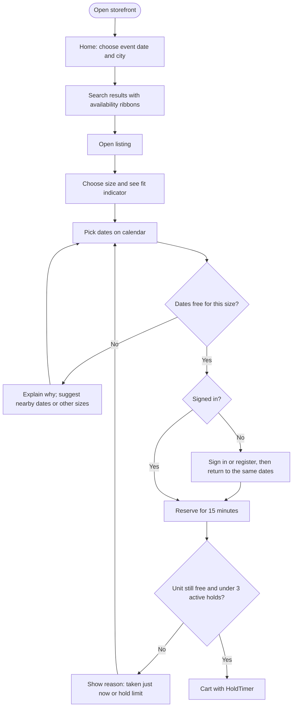

### 3.2 Checkout and payment

```mermaid
sequenceDiagram
    autonumber
    actor C as Customer
    participant SF as Storefront
    participant API as Medusa API
    participant WF as Workflow engine
    participant PAY as Payment provider
    participant DB as PostgreSQL

    C->>SF: Add rental (variant, dates)
    SF->>API: POST /store/carts/:id/rentals
    API->>WF: add-rental-to-cart
    WF->>DB: Insert booking status=held (exclusion constraint guards overlap)
    DB-->>WF: OK (or 23P01 overlap, retry another unit)
    WF-->>API: Line item + booking_id + hold_expires_at
    API-->>SF: Cart with hold timer

    C->>SF: Pay and confirm
    SF->>API: Complete cart
    API->>WF: Cart completion hook validates holds
    WF->>PAY: Capture rental fee and cleaning fee; secure deposit
    alt Payment success
        PAY-->>WF: Success
        WF->>DB: Booking confirmed, deposit secured, ledger entries pending
        WF-->>API: Order created, event rental.booking.confirmed
        API-->>SF: Confirmation
    else Payment failure or hold expired
        PAY-->>WF: Failure
        WF->>DB: Compensate: keep hold if time remains, else expire; void/refund any captured amount
        WF-->>API: Error with next step
        API-->>SF: Show retry or re-reserve
    end
```

### 3.3 After booking: handover, wear, return

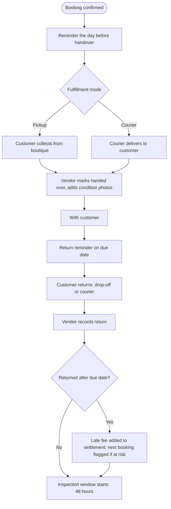

### 3.4 Inspection, dispute and settlement

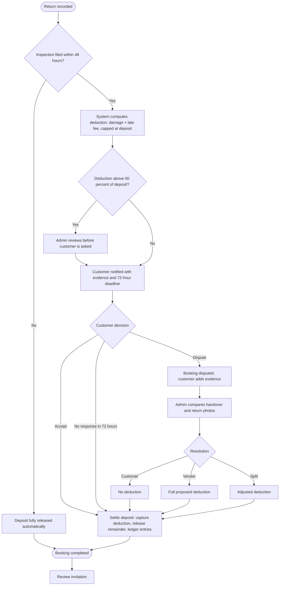

### 3.5 Cancellation

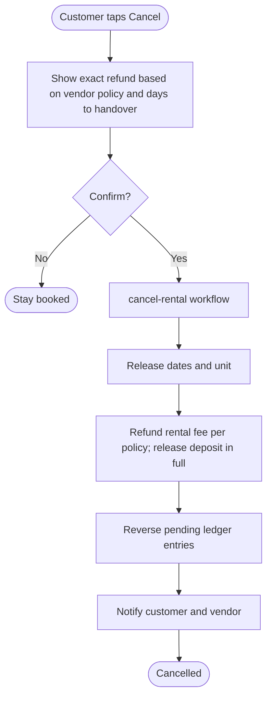

Vendor-initiated cancellation follows the same workflow with a 100% refund, a vendor penalty ledger entry, and an increment of the vendor's 90-day cancellation counter (auto-pause at 3).

### 3.6 Fit and measurements

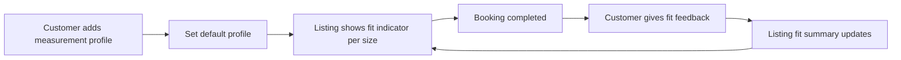

## 4. Vendor flows

### 4.1 Onboarding

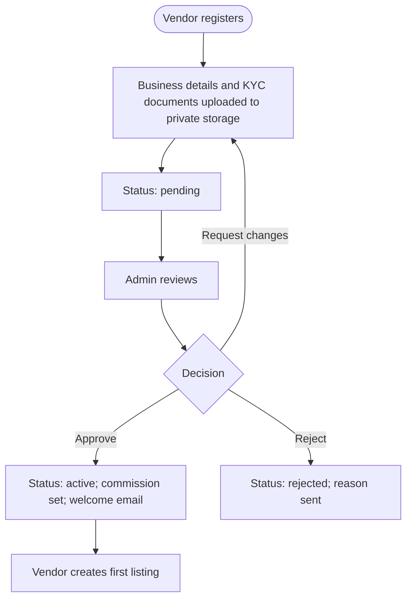

### 4.2 Listing and inventory

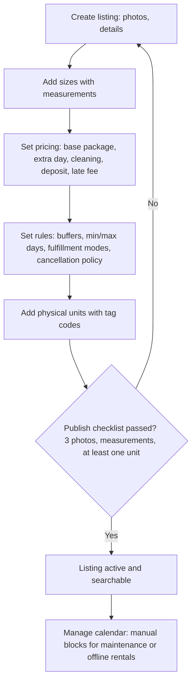

### 4.3 Daily operations

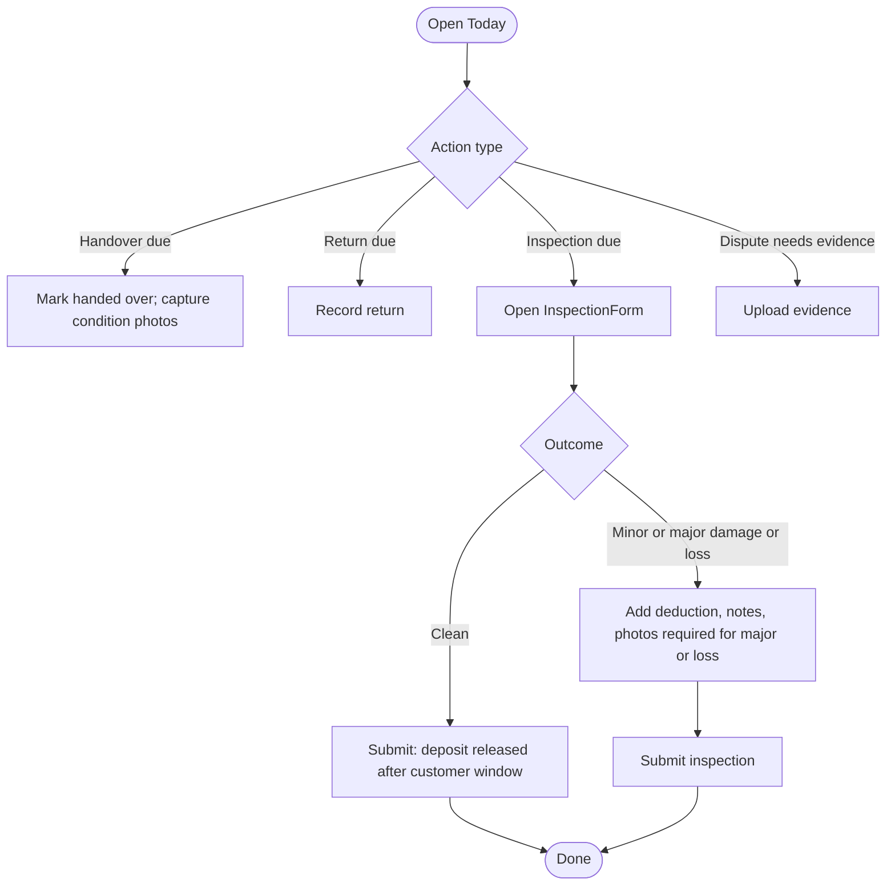

## 5. Admin and system flows

### 5.1 Payout cycle

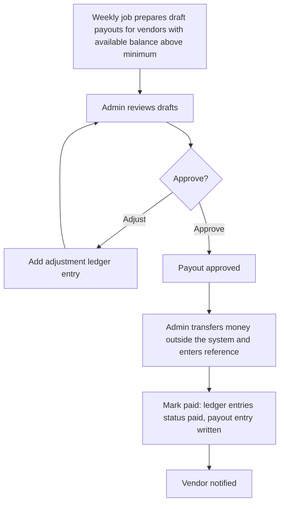

### 5.2 Scheduled jobs and automated transitions

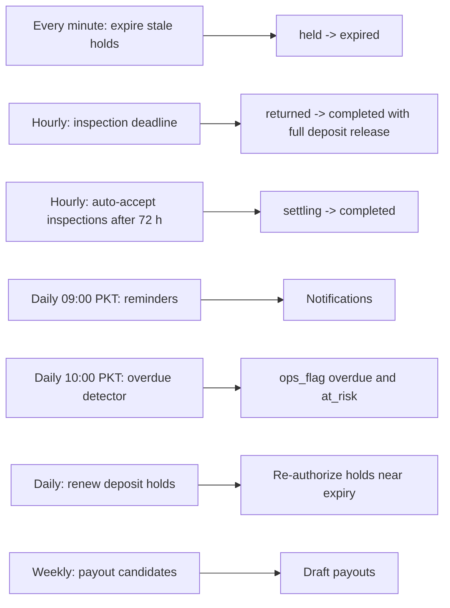

## 6. Booking state machine

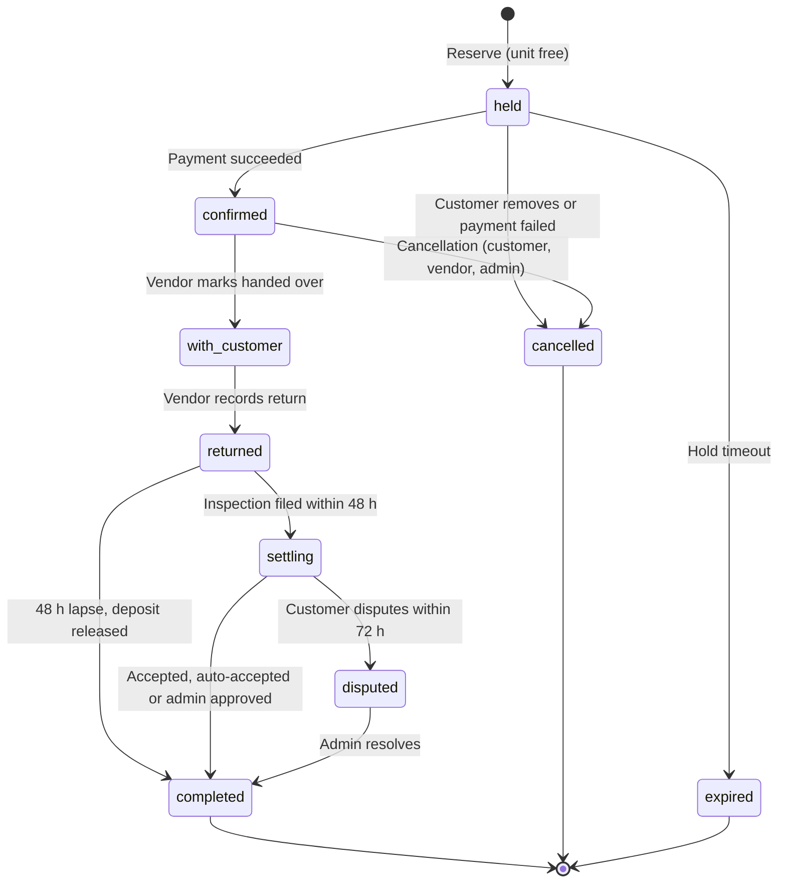

Occupying states (block the unit's calendar): `held`, `confirmed`, `with_customer`, `returned`, `settling`, `disputed`.

## 7. Compensation and failure flows

| Failure | Detected by | System response | User-visible outcome |
|---|---|---|---|
| Payment fails after hold | Payment provider response / webhook | Keep the hold if time remains; otherwise expire it; void or refund any partial capture | "Payment didn't go through. Still reserved for 6:12." |
| Hold expires before payment completes | Cart completion hook | Reject completion; refund if captured; no booking is created | "Your reservation ended. Reserve again." |
| Two customers reserve the last unit simultaneously | Exclusion constraint (`23P01`) | Loser retries another unit or gets `UNAVAILABLE` | "Booked a moment ago. Try these dates or another size." |
| Payment webhook arrives twice | Idempotency by event id | Second delivery ignored | None |
| Deposit capture fails at settlement | `settle-deposit` step | Compensate ledger entries; set `ops_flag = settlement_failed`; alert admin | "We're finalizing your deposit." |
| Notification provider down | Subscriber retry | Retry with backoff; never block the workflow | Delayed message |
| Vendor never inspects | `inspection-deadline` job | Auto-release deposit | "Deposit returned: full amount." |
| Courier status mismatch | Courier callback validation | Ignore invalid transitions; log | None |

## 8. Notification matrix

| Event | Customer | Vendor | Admin |
|---|---|---|---|
| Booking confirmed | Email (+ WhatsApp stub) | Email, portal alert | |
| Handover reminder (day before) | Email | Email | |
| Return reminder (due date) | Email | | |
| Return overdue | Email | Email, portal flag | Dashboard flag |
| Inspection submitted | Email (decision deadline) | Confirmation | |
| Dispute opened | Confirmation | Email | Queue item |
| Dispute resolved | Email | Email | |
| Booking completed | Email (deposit amount, review invite) | Email (earnings available) | |
| Payout paid | | Email | |
| Vendor submitted for approval | | | Queue item |

## 9. Permissions matrix

| Capability | Customer | Vendor owner | Vendor staff | Admin |
|---|---|---|---|---|
| Search and view listings | ✔ | ✔ | ✔ | ✔ |
| Reserve, pay, cancel own booking | ✔ | | | |
| Manage listings and units | | ✔ | ✔ | |
| Mark handed over / returned, file inspection | | ✔ | ✔ | |
| View earnings and payouts | | ✔ | | ✔ |
| Edit payout method | | ✔ | | |
| Open dispute, accept inspection | ✔ | | | |
| Resolve disputes | | | | ✔ |
| Approve vendors, set commission | | | | ✔ |
| Approve and mark payouts paid | | | | ✔ |

Vendor routes are always scoped to the authenticated vendor; cross-vendor access returns 404.
