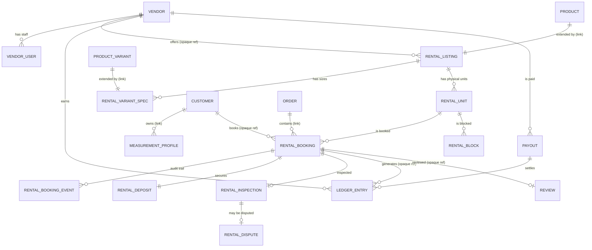

# Libaas Kiraya — Backend Schema

| Field | Value |
|---|---|
| Document version | 1.0 (Draft for build) |
| Date | 21 October 2026 |
| Author | Saleh |
| Database | PostgreSQL 15+ (`btree_gist` extension required) |
| ORM / modeling | Medusa v2 Data Model Language (DML) per module, migrations generated by Medusa plus reviewed raw SQL |
| Related docs | `TRD.md` (architecture, workflows), `PRD.md` (rules), `Appflow.md` (state transitions) |

---

## 1. Conventions

1. **Medusa-managed columns.** Every DML model also gets `created_at`, `updated_at`, `deleted_at`. They are omitted from the tables below. Booking-like entities are never hard-deleted.
2. **IDs.** Prefixed ULIDs, e.g. `rbk_01J…` (booking). Prefix is shown per table.
3. **Money.** Columns typed `bigNumber` are decimal-safe; Medusa also creates a companion `raw_<column>` JSON column. Amounts are in major currency units (PKR). Currency is stored per row where relevant.
4. **Calendar dates.** DML has no pure `date` type, so calendar dates are stored as `dateTime` holding **00:00:00Z of the Asia/Karachi calendar date** (e.g. 14 Dec 2026 → `2026-12-14T00:00:00Z`). The API converts `YYYY-MM-DD` ⇄ this instant. A **generated stored column** `blocked_during` (type `daterange`) is derived from it for constraints and queries (§5).
5. **Cross-module references.** Columns that reference other modules' records (`product_id`, `variant_id`, `customer_id`, `order_id`, `vendor_id` in the rental module) are **opaque text** without foreign keys. Medusa module links provide the query-graph relations; workflows enforce integrity. Intra-module relations use real foreign keys.
6. **Enums** are DML `enum` columns (stored as text with a check constraint).
7. **Arrays/JSON.** `array` = Postgres text array; `json` = JSONB.

## 2. Entity-relationship diagram



`CUSTOMER`, `PRODUCT`, `PRODUCT_VARIANT`, `ORDER` are Medusa core entities.

## 3. Module: `vendor`

### 3.1 `vendor` (prefix `ven`)

| Column | Type | Null | Notes |
|---|---|---|---|
| id | id | no | PK |
| name | text | no | Display name |
| handle | text | no | Unique, URL slug |
| email | text | no | Unique |
| phone | text | no | |
| whatsapp | text | yes | |
| city | text | no | |
| address | text | yes | |
| description | text | yes | |
| logo_key | text | yes | Object key in public bucket |
| instagram_handle | text | yes | |
| status | enum | no | `pending`, `active`, `suspended`, `rejected` (default `pending`) |
| kyc_status | enum | no | `not_submitted`, `submitted`, `verified`, `rejected` |
| kyc_document_keys | array | yes | **Private** bucket keys only; no document numbers stored |
| commission_bps | number | no | Basis points; default 1200 (12%) |
| default_cancellation_policy | enum | no | `flexible`, `standard`, `strict` |
| payout_method | enum | yes | `bank_transfer`, `jazzcash`, `easypaisa` |
| payout_account_ref | text | yes | Application-level encrypted value |
| cancellations_90d | number | no | Maintained by workflow; drives auto-pause |
| metadata | json | yes | |

Constraints: `UNIQUE(handle)`, `UNIQUE(email)`, `CHECK(commission_bps BETWEEN 0 AND 3000)`.

### 3.2 `vendor_user` (prefix `vusr`)

| Column | Type | Null | Notes |
|---|---|---|---|
| id | id | no | PK |
| vendor_id | text (FK → vendor.id) | no | |
| auth_identity_id | text | no | Medusa auth identity (actor type `vendor`) |
| name | text | no | |
| email | text | no | Unique |
| role | enum | no | `owner`, `staff` |

## 4. Module: `rental`

### 4.1 `rental_setting` (prefix `rset`) — single row

| Column | Type | Default | Notes |
|---|---|---|---|
| hold_ttl_minutes | number | 15 | |
| max_active_holds | number | 3 | Per customer |
| inspection_window_hours | number | 48 | After `returned` |
| dispute_window_hours | number | 72 | After inspection submitted |
| default_lead_buffer_days | number | 1 | |
| default_return_buffer_days | number | 2 | |
| default_commission_bps | number | 1200 | |
| admin_review_deduction_pct | number | 50 | Deduction above this % of deposit needs admin review |
| min_payout_amount | bigNumber | 5000 | PKR |
| vendor_cancel_penalty_amount | bigNumber | 2000 | PKR |

### 4.2 `rental_listing` (prefix `rlst`)

| Column | Type | Null | Notes |
|---|---|---|---|
| id | id | no | PK |
| product_id | text | no | Medusa product (linked); `UNIQUE` |
| vendor_id | text | no | Opaque ref |
| city | text | no | Search filter |
| status | enum | no | `draft`, `active`, `paused` |
| base_amount | bigNumber | no | Price for `base_days` |
| base_days | number | no | Default 3 |
| extra_day_amount | bigNumber | no | Per day beyond `base_days` |
| cleaning_fee_amount | bigNumber | no | Default 0 |
| deposit_amount | bigNumber | no | |
| late_fee_amount | bigNumber | no | Per day late |
| lead_buffer_days | number | no | Default from settings |
| return_buffer_days | number | no | Default from settings |
| min_days | number | no | Default 1 |
| max_days | number | no | Default 7 |
| fulfillment_modes | array | no | Subset of `pickup`, `courier` |
| cancellation_policy | enum | no | `flexible`, `standard`, `strict` |
| occasion_tags | array | yes | e.g. `barat`, `walima`, `mehndi`, `nikkah` |
| rating_avg | float | no | Denormalized (subscriber-maintained) |
| rating_count | number | no | |
| fit_small_count / fit_true_count / fit_large_count | number | no | Denormalized fit feedback |

Constraints: `CHECK(base_days >= 1)`, `CHECK(min_days <= max_days)`, `CHECK(deposit_amount >= 0)`, all amounts `>= 0`.

### 4.3 `rental_variant_spec` (prefix `rspec`)

| Column | Type | Null | Notes |
|---|---|---|---|
| id | id | no | PK |
| listing_id | text (FK → rental_listing.id) | no | |
| variant_id | text | no | Medusa variant (linked); `UNIQUE` |
| size_label | text | no | e.g. `S`, `M`, `Custom` |
| measurements | json | no | e.g. `{ "bust_in": 36, "waist_in": 30, "hip_in": 38, "shoulder_in": 14.5, "length_in": 44 }` |
| alterable | boolean | no | Can the vendor adjust fit |
| alteration_notes | text | yes | |

### 4.4 `rental_unit` (prefix `runit`)

| Column | Type | Null | Notes |
|---|---|---|---|
| id | id | no | PK |
| listing_id | text (FK → rental_listing.id) | no | |
| variant_id | text | no | Opaque ref |
| vendor_id | text | no | Opaque ref |
| tag_code | text | no | Vendor's physical tag, e.g. `LEH-014` |
| condition_grade | enum | no | `A`, `B`, `C` |
| status | enum | no | `active`, `maintenance`, `retired` |
| last_booked_at | dateTime | yes | Used to spread wear when picking a unit |
| notes | text | yes | |

Constraints: `UNIQUE(vendor_id, tag_code)`.

### 4.5 `rental_booking` (prefix `rbk`)

| Column | Type | Null | Notes |
|---|---|---|---|
| id | id | no | PK |
| listing_id | text (FK → rental_listing.id) | no | |
| unit_id | text (FK → rental_unit.id) | no | |
| variant_id | text | no | Opaque ref |
| vendor_id | text | no | Opaque ref |
| customer_id | text | no | Opaque ref |
| cart_id | text | yes | |
| order_id | text | yes | Set on confirmation |
| line_item_id | text | yes | |
| event_date | dateTime | no | Calendar date convention (§1.4) |
| rental_start | dateTime | no | Handover/delivery date |
| rental_end | dateTime | no | Return due date |
| blocked_start | dateTime | no | `rental_start − lead_buffer_days` |
| blocked_end | dateTime | no | `rental_end + return_buffer_days` |
| blocked_during | daterange | no | **Generated stored** (see §5.1) |
| days | number | no | Inclusive rental days |
| status | enum | no | See §8 |
| ops_flag | enum | no | `none`, `overdue`, `at_risk`, `settlement_failed`, `cancel_failed` |
| hold_expires_at | dateTime | yes | Set while `held` |
| fulfillment_mode | enum | no | `pickup`, `courier` |
| delivery_address | json | yes | Snapshot |
| currency_code | text | no | `pkr` |
| rental_fee | bigNumber | no | |
| cleaning_fee | bigNumber | no | |
| deposit_amount | bigNumber | no | Snapshot of listing deposit |
| platform_fee | bigNumber | no | `rental_fee × commission_bps / 10000` |
| pricing_snapshot | json | no | `{ base_amount, base_days, extra_day_amount, late_fee_amount, commission_bps, cancellation_policy }` frozen at hold time |
| cancelled_by | enum | yes | `customer`, `vendor`, `admin`, `system` |
| cancellation_reason | text | yes | |
| cancelled_at / dispatched_at / returned_at / inspection_due_at / completed_at | dateTime | yes | Lifecycle timestamps |

Constraints (beyond the exclusion constraint in §5.1):

- `CHECK(blocked_start <= rental_start AND rental_start <= rental_end AND rental_end <= blocked_end)`
- `CHECK(days >= 1)`; `CHECK(rental_fee >= 0 AND deposit_amount >= 0 AND platform_fee >= 0)`
- `CHECK(status <> 'held' OR hold_expires_at IS NOT NULL)`

### 4.6 `rental_block` (prefix `rblk`) — manual calendar blocks

| Column | Type | Null | Notes |
|---|---|---|---|
| id | id | no | PK |
| unit_id | text (FK → rental_unit.id) | no | |
| vendor_id | text | no | |
| start_date / end_date | dateTime | no | Inclusive, calendar date convention |
| blocked_during | daterange | no | Generated stored |
| reason | enum | no | `maintenance`, `offline_rental`, `other` |
| note | text | yes | |

Constraint: exclusion on `(unit_id, blocked_during)` (no overlapping blocks).

### 4.7 `rental_booking_event` (prefix `rbe`) — audit trail

| Column | Type | Null | Notes |
|---|---|---|---|
| id | id | no | PK |
| booking_id | text (FK → rental_booking.id) | no | |
| from_status | text | yes | |
| to_status | text | no | |
| actor_type | enum | no | `customer`, `vendor`, `admin`, `system` |
| actor_id | text | yes | |
| meta | json | yes | Reason, workflow execution id, amounts |

Append-only (no update/delete in application code).

### 4.8 `rental_deposit` (prefix `rdep`)

| Column | Type | Null | Notes |
|---|---|---|---|
| id | id | no | PK |
| booking_id | text (FK → rental_booking.id) | no | `UNIQUE` |
| mode | enum | no | `hold`, `charge_refund` |
| amount | bigNumber | no | |
| status | enum | no | `pending`, `secured`, `settled`, `released`, `failed` |
| payment_collection_id | text | yes | Medusa payment collection |
| captured_amount | bigNumber | no | Default 0 (deduction captured) |
| released_amount | bigNumber | no | Default 0 |
| authorization_expires_at | dateTime | yes | Hold mode only |
| secured_at / settled_at | dateTime | yes | |

`secured` = authorized (hold) or captured (charge-and-refund). Constraint: `CHECK(captured_amount + released_amount <= amount)`.

### 4.9 `rental_inspection` (prefix `rins`)

| Column | Type | Null | Notes |
|---|---|---|---|
| id | id | no | PK |
| booking_id | text (FK → rental_booking.id) | no | `UNIQUE` |
| filed_by | text | no | Vendor user id |
| outcome | enum | no | `clean`, `minor_damage`, `major_damage`, `loss` |
| damage_deduction | bigNumber | no | Default 0 |
| late_days | number | no | Default 0 |
| late_fee | bigNumber | no | Default 0 |
| total_deduction | bigNumber | no | `damage_deduction + late_fee`, capped at deposit |
| notes | text | yes | |
| photo_keys | array | no | Private bucket keys; ≥ 3 required for `major_damage` and `loss` (workflow validation) |
| status | enum | no | `submitted`, `needs_admin_review`, `accepted`, `auto_accepted`, `disputed`, `resolved` |
| submitted_at | dateTime | no | |
| dispute_deadline | dateTime | no | `submitted_at + dispute_window_hours` |
| decided_at | dateTime | yes | |

### 4.10 `rental_dispute` (prefix `rdis`)

| Column | Type | Null | Notes |
|---|---|---|---|
| id | id | no | PK |
| inspection_id | text (FK → rental_inspection.id) | no | `UNIQUE` (one dispute per inspection) |
| booking_id | text | no | |
| opened_by | text | no | Customer id |
| reason | text | no | |
| evidence_keys | array | yes | Private bucket keys |
| status | enum | no | `open`, `under_review`, `resolved` |
| resolution | enum | yes | `customer`, `vendor`, `split` |
| resolved_deduction | bigNumber | yes | Final deduction after arbitration |
| admin_notes | text | yes | |
| resolved_by | text | yes | Admin user id |
| opened_at / resolved_at | dateTime | no / yes | |

## 5. Constraints and raw SQL (migration additions)

### 5.1 Generated columns and exclusion constraints

Added in the same migration file that creates `rental_booking` and `rental_block` (DML cannot express these). `AT TIME ZONE 'UTC'` on a `timestamptz` is immutable, which is required for generated columns and index expressions.

```sql
CREATE EXTENSION IF NOT EXISTS btree_gist;

ALTER TABLE rental_booking
  ADD COLUMN blocked_during daterange
  GENERATED ALWAYS AS (
    daterange(
      (blocked_start AT TIME ZONE 'UTC')::date,
      (blocked_end   AT TIME ZONE 'UTC')::date,
      '[]'
    )
  ) STORED;

ALTER TABLE rental_booking
  ADD CONSTRAINT rental_booking_no_overlap
  EXCLUDE USING gist (unit_id WITH =, blocked_during WITH &&)
  WHERE (status IN ('held','confirmed','with_customer','returned','settling','disputed')
         AND deleted_at IS NULL);

ALTER TABLE rental_block
  ADD COLUMN blocked_during daterange
  GENERATED ALWAYS AS (
    daterange(
      (start_date AT TIME ZONE 'UTC')::date,
      (end_date   AT TIME ZONE 'UTC')::date,
      '[]'
    )
  ) STORED;

ALTER TABLE rental_block
  ADD CONSTRAINT rental_block_no_overlap
  EXCLUDE USING gist (unit_id WITH =, blocked_during WITH &&)
  WHERE (deleted_at IS NULL);
```

> The generated column is unknown to Medusa's model snapshot. Keep it out of DML; read it only in raw queries and constraints. An integration test asserts both constraints exist and reject overlaps.

### 5.2 Other check constraints

```sql
ALTER TABLE rental_booking
  ADD CONSTRAINT rental_booking_dates_ok
  CHECK (blocked_start <= rental_start AND rental_start <= rental_end AND rental_end <= blocked_end);

ALTER TABLE rental_booking
  ADD CONSTRAINT rental_booking_hold_has_expiry
  CHECK (status <> 'held' OR hold_expires_at IS NOT NULL);

ALTER TABLE rental_deposit
  ADD CONSTRAINT rental_deposit_amounts_ok
  CHECK (captured_amount + released_amount <= amount);

ALTER TABLE review
  ADD CONSTRAINT review_rating_range CHECK (rating BETWEEN 1 AND 5);
```

## 6. Module: `ledger`

### 6.1 `ledger_entry` (prefix `led`) — append-only

| Column | Type | Null | Notes |
|---|---|---|---|
| id | id | no | PK |
| vendor_id | text | no | |
| booking_id | text | yes | Opaque ref |
| payout_id | text (FK → payout.id) | yes | Set when settled by a payout |
| type | enum | no | `rental_earning`, `commission`, `cleaning_fee`, `deduction_earning`, `refund_reversal`, `penalty`, `adjustment`, `payout` |
| amount | bigNumber | no | **Signed**: credit to vendor positive, debit negative |
| currency_code | text | no | |
| status | enum | no | `pending`, `available`, `paid`, `reversed` |
| available_at | dateTime | yes | Set when booking completes |
| idempotency_key | text | no | `UNIQUE`; prevents duplicate entries on workflow retries (e.g. `booking:{id}:rental_earning`) |
| memo | text | yes | |
| metadata | json | yes | |

Rules:

- Rows are never updated except `status`, `available_at`, `payout_id` transitions performed by workflows; corrections use new `adjustment` entries.
- **Balances** are derived: `available_balance = SUM(amount) WHERE status = 'available'`; `pending_balance` similarly.
- On confirmation the booking creates: `rental_earning (+rental_fee)`, `commission (−platform_fee)`, `cleaning_fee (+cleaning)` — all `pending`.
- On completion: pending entries become `available`; a `deduction_earning (+deduction)` entry is added as `available`.

### 6.2 `payout` (prefix `pay`)

| Column | Type | Null | Notes |
|---|---|---|---|
| id | id | no | PK |
| vendor_id | text | no | |
| amount | bigNumber | no | Sum of included entries |
| currency_code | text | no | |
| method | enum | no | `bank_transfer`, `jazzcash`, `easypaisa` |
| reference | text | yes | External transfer reference |
| status | enum | no | `draft`, `approved`, `paid`, `failed` |
| period_start / period_end | dateTime | no | |
| approved_by | text | yes | Admin user id |
| approved_at / paid_at | dateTime | yes | |

## 7. Modules: `measurement` and `review`

### 7.1 `measurement_profile` (prefix `mprof`)

| Column | Type | Null | Notes |
|---|---|---|---|
| id | id | no | PK |
| customer_id | text | no | Linked to Medusa customer |
| label | text | no | e.g. "Me", "Sister" |
| garment_type | enum | no | `women`, `men`, `kids` |
| unit | enum | no | `in`, `cm` |
| bust_chest / waist / hips / shoulder / height | float | yes | Stored in the chosen unit, normalized to inches at compare time |
| is_default | boolean | no | One default per customer (partial unique index) |
| notes | text | yes | |

### 7.2 `review` (prefix `rev`)

| Column | Type | Null | Notes |
|---|---|---|---|
| id | id | no | PK |
| booking_id | text | no | `UNIQUE`; workflow verifies booking is `completed` |
| customer_id | text | no | |
| vendor_id | text | no | |
| listing_id | text | no | |
| rating | number | no | 1–5 |
| fit | enum | yes | `small`, `true`, `large` |
| body | text | yes | |
| photo_keys | array | yes | Public bucket after moderation |
| status | enum | no | `published`, `hidden` |

## 8. Booking state machine

| From | To | Trigger / actor | Guard |
|---|---|---|---|
| — | `held` | Customer adds rental to cart | Unit free for blocked period |
| `held` | `confirmed` | Payment succeeded (cart completed) | Hold not expired |
| `held` | `expired` | Hold job / reserve step | `hold_expires_at < now()` |
| `held` | `cancelled` | Customer removes item / payment failed | |
| `confirmed` | `with_customer` | Vendor marks dispatched | Not before `rental_start − 1 day` |
| `confirmed` | `cancelled` | Customer, vendor or admin cancels | Refund per policy |
| `with_customer` | `returned` | Vendor marks returned | |
| `returned` | `settling` | Vendor files inspection | Within 48 h; else auto-release path |
| `returned` | `completed` | 48 h lapse without inspection | Deposit fully released |
| `settling` | `completed` | Customer accepts / 72 h lapse / admin approves | Deposit settled |
| `settling` | `disputed` | Customer disputes | Within 72 h |
| `disputed` | `completed` | Admin resolves | Resolution applied |

Every transition writes a `rental_booking_event` row and, where applicable, emits a domain event.

## 9. Indexes

| Table | Index | Purpose |
|---|---|---|
| rental_booking | GiST `(unit_id, blocked_during)` (created by exclusion constraint) | Overlap guard, availability anti-join |
| rental_booking | `(vendor_id, status, rental_start)` | Vendor queue |
| rental_booking | `(customer_id, status)` | "My bookings" |
| rental_booking | `(status, hold_expires_at)` WHERE `status = 'held'` (partial) | Hold-expiry job |
| rental_booking | `(status, inspection_due_at)` WHERE `status = 'returned'` (partial) | Inspection-deadline job |
| rental_booking | `(status, rental_end)` WHERE `status = 'with_customer'` (partial) | Overdue detector |
| rental_booking | `(order_id)` | Order lookup |
| rental_unit | `(listing_id, variant_id, status)` | Candidate unit lookup |
| rental_listing | `(city, status)` | Search |
| rental_listing | GIN `(occasion_tags)` | Occasion filter |
| rental_block | GiST `(unit_id, blocked_during)` | Block overlap, availability |
| rental_booking_event | `(booking_id, created_at)` | Timeline |
| rental_inspection | `(status, dispute_deadline)` | Auto-accept job |
| ledger_entry | `(vendor_id, status)` | Balances |
| ledger_entry | `UNIQUE(idempotency_key)` | Idempotency |
| payout | `(vendor_id, status)` | Payout queue |
| review | `(listing_id, status, created_at)` | Listing reviews |
| measurement_profile | `UNIQUE(customer_id) WHERE is_default AND deleted_at IS NULL` | One default profile |

## 10. Module links (Medusa `defineLink`)

| Link | Left | Right | Notes |
|---|---|---|---|
| product–vendor | `product` | `vendor` | Many products per vendor; used for vendor storefront filters |
| product–listing | `product` | `rental_listing` | One-to-one |
| variant–spec | `product_variant` | `rental_variant_spec` | One-to-one |
| order–booking | `order` | `rental_booking` | Via order id and line item id |
| customer–measurement | `customer` | `measurement_profile` | One-to-many |
| vendor–ledger | `vendor` | `ledger_entry` | Read-side convenience |

Run `medusa db:sync-links` after defining links.

## 11. Example DML (abbreviated)

```ts
// src/modules/rental/models/rental-booking.ts
import { model } from "@medusajs/framework/utils"

export const RentalBooking = model
  .define("rental_booking", {
    id: model.id({ prefix: "rbk" }).primaryKey(),
    variant_id: model.text(),
    vendor_id: model.text(),
    customer_id: model.text(),
    cart_id: model.text().nullable(),
    order_id: model.text().nullable(),
    line_item_id: model.text().nullable(),
    event_date: model.dateTime(),
    rental_start: model.dateTime(),
    rental_end: model.dateTime(),
    blocked_start: model.dateTime(),
    blocked_end: model.dateTime(),
    days: model.number(),
    status: model
      .enum(["held", "confirmed", "with_customer", "returned", "settling",
             "disputed", "completed", "cancelled", "expired"])
      .default("held"),
    ops_flag: model
      .enum(["none", "overdue", "at_risk", "settlement_failed", "cancel_failed"])
      .default("none"),
    hold_expires_at: model.dateTime().nullable(),
    fulfillment_mode: model.enum(["pickup", "courier"]),
    currency_code: model.text(),
    rental_fee: model.bigNumber(),
    cleaning_fee: model.bigNumber(),
    deposit_amount: model.bigNumber(),
    platform_fee: model.bigNumber(),
    pricing_snapshot: model.json(),
    // relations
    listing: model.belongsTo(() => RentalListing, { mappedBy: "bookings" }),
    unit: model.belongsTo(() => RentalUnit, { mappedBy: "bookings" }),
  })
  .indexes([
    { on: ["vendor_id", "status", "rental_start"] },
    { on: ["customer_id", "status"] },
    { on: ["order_id"] },
  ])
```

## 12. Seed data

`pnpm seed` (idempotent) creates:

| Entity | Count / notes |
|---|---|
| Regions / currency | Pakistan, PKR |
| Cities | Rawalpindi, Islamabad, Lahore |
| Vendors | 6 (5 active, 1 pending), commission 10–15% |
| Listings | ~60 across bridal lehenga, sherwani, formal kurta, jewelry sets |
| Units | ~150 (some listings with 2–3 units) |
| Bookings | One in every status; overlapping attempt fixtures for tests |
| Special cases | 1 disputed booking with evidence, 1 overdue return with an at-risk next booking, 1 vendor with 2 recent cancellations |
| Ledger | Pending, available and paid entries; one draft payout |
| Customers | 5 with measurement profiles |

## 13. Retention and privacy

| Data | Retention |
|---|---|
| Bookings, ledger, payouts | 7 years (financial records) |
| Inspection and dispute photos | 12 months after booking completion, then deleted from storage; DB keeps metadata |
| Vendor KYC documents | Vendor's active period + 12 months |
| Measurement profiles | Until the customer deletes them or the account |
| Audit events | 7 years |

Personal data export and deletion requests anonymize customer-linked fields while preserving financial rows.
