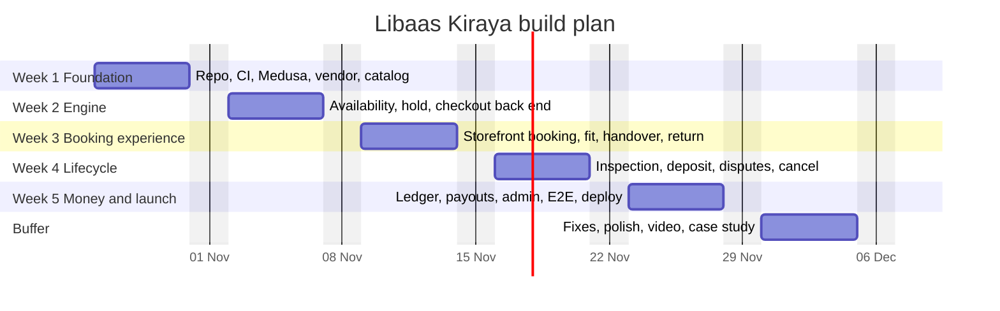

# Libaas Kiraya — Implementation Plan

| Field | Value |
|---|---|
| Document version | 1.0 (Draft for build) |
| Date | 21 October 2026 |
| Author | Saleh |
| Proposed start | Monday 26 October 2026 |
| Planned duration | 5 weeks core build + 1 buffer week |
| Related docs | `PRD.md`, `TRD.md`, `Backend-Schema.md`, `Appflow.md`, `UI-UX-Design.md` |

> **Scope note.** Earlier in the discussion the project was sketched at about 4 weeks. With the complete scope in the PRD (inspection, disputes, ledger, payouts, vendor portal, admin extensions) a realistic solo estimate is **5 weeks of focused work (~35 hours per week)**. If time is tighter, use the **cut line in §4** to ship a strong 4-week version.

---

## 1. Planning assumptions

- One developer, about 7 focused hours per day, 5 days per week. Estimates are in hours and include writing tests.
- Medusa v2 (target ≥ 2.15; pin one release line), Node.js LTS, PostgreSQL 15+, Redis, Next.js.
- Payment and courier integrations are sandbox or simulated (see `PRD.md` §10).
- Work in vertical slices: each week ends with something demonstrable end to end.
- Every workflow ships with its compensation test; every endpoint ships with an authorization test.

## 2. Timeline

## 3. Work breakdown

Estimates are focused hours. Dependencies reference task IDs.

### Week 1 — Foundation and catalog (≈ 37 h)

| ID | Task | Est. | Depends | Deliverable |
|---|---|---|---|---|
| W1-01 | Monorepo, TypeScript strict, ESLint/Prettier, commit hooks, Docker Compose (Postgres, Redis, MinIO, Mailpit) | 3 | — | `docker compose up` runs the stack |
| W1-02 | Medusa v2 backend init; Redis event bus and workflow engine; PKR region, sales channel, stock location; env validation | 3 | W1-01 | Backend boots; admin login works |
| W1-03 | Next.js storefront shell: Tailwind theme from design tokens, fonts, layout, base components | 4 | W1-01 | Styled shell with token page |
| W1-04 | CI pipeline: lint, typecheck, unit tests, build | 2 | W1-01 | Green pipeline on PR |
| W1-05 | `vendor` module (models, migration, service), `vendor` auth actor, `onboard-vendor` workflow, admin approve/reject route | 6 | W1-02 | Vendor can register; admin approves |
| W1-06 | `rental` module part 1: `rental_setting`, `rental_listing`, `rental_variant_spec`, `rental_unit` + migrations; links to product, variant, vendor | 6 | W1-02 | Models and links synced |
| W1-07 | Vendor API: listing, variant, unit CRUD; signed upload URLs to MinIO; scoping middleware and authorization tests | 5 | W1-05, W1-06 | Vendor creates a listing via API |
| W1-08 | Seed script v1: vendors, listings, units, customers | 3 | W1-07 | `pnpm seed` creates demo catalog |
| W1-09 | Storefront: home, search page (no availability yet), listing detail (static data) | 5 | W1-03, W1-08 | Browsable catalog |

**Exit criteria:** vendor registration → approval → listing creation works; catalog browsable; CI green; ADRs recorded in `docs/`.

### Week 2 — Availability engine and booking back end (≈ 37 h)

| ID | Task | Est. | Depends | Deliverable |
|---|---|---|---|---|
| W2-01 | `rental_booking`, `rental_block`, `rental_booking_event`, `rental_deposit` models; migration with `btree_gist`, generated `blocked_during` column, exclusion and check constraints; constraint tests | 5 | W1-06 | Overlap rejected by the database |
| W2-02 | Pricing and cancellation-policy pure functions (quote, extra days, deposit, late fee, refund tiers) with unit and property tests | 4 | — | Tested pricing library |
| W2-03 | `reserve-unit` step and `reserve-rental` workflow: validation, stale-hold expiry, candidate selection, retry on `23P01`, compensation | 6 | W2-01, W2-02 | Holds created safely |
| W2-04 | **Concurrency test**: 50 parallel reserves on one unit/date → exactly one success; run in CI | 3 | W2-03 | Required CI gate |
| W2-05 | `add-rental-to-cart` (custom line price, booking in metadata), cart-completion hook, `confirm-rental` workflow, deposit record, domain events | 8 | W2-03 | Cart with rental completes into an order |
| W2-06 | Payment: `simulated-wallet` provider and Stripe test integration; provider capability flag (`supportsHold`); webhook handler with idempotency | 5 | W2-05 | Payments succeed/fail in tests |
| W2-07 | Store endpoints: `search`, `availability` (calendar), `quote`; query plans verified with `EXPLAIN` on seeded data | 5 | W2-01 | Date-aware search |
| W2-08 | `expire-stale-holds` job; hold-limit rule (3 per customer) | 1 | W2-03 | Holds auto-release |

**Exit criteria:** from an API client: search by date → reserve → pay → booking `confirmed`; payment failure releases or keeps hold correctly; concurrency test green.

### Week 3 — Booking experience and handover/return (≈ 36 h)

| ID | Task | Est. | Depends | Deliverable |
|---|---|---|---|---|
| W3-01 | Storefront: search results with AvailabilityRibbon, listing detail with AvailabilityCalendar, size chips, PriceBreakdown, sticky reserve bar | 9 | W2-07 | Date-first browsing |
| W3-02 | Storefront: sign-in/register, cart with HoldTimer, three-step checkout, payment, confirmation, failure states | 9 | W2-05, W2-06 | Customer completes a booking in UI |
| W3-03 | `measurement` module, store API, measurements UI, fit calculation and indicator | 6 | W1-06 | Fit shown per size |
| W3-04 | Account: My bookings list and detail with StatusTimeline | 4 | W3-02 | Customer sees lifecycle |
| W3-05 | Vendor: bookings queue, `mark-dispatched` and `mark-returned` workflows and endpoints, vendor UI (Today, bookings, handover photos), email notifications base (subscribers, templates) | 8 | W2-05 | Vendor handles handover and return |

**Exit criteria (Demo M3):** a real person can search, fit-check, reserve, pay, and the vendor can hand over and record the return, all through the UI.

### Week 4 — Inspection, deposit, disputes, cancellation (≈ 36 h)

| ID | Task | Est. | Depends | Deliverable |
|---|---|---|---|---|
| W4-01 | `settle-deposit` workflow with payment capture/refund for both deposit modes; ops-flag on failure | 7 | W2-06, W3-05 | Deposit settled correctly |
| W4-02 | `rental_inspection` model, `submit-inspection` workflow (deduction cap, admin-review gate, photo rules), vendor InspectionForm UI | 7 | W4-01 | Vendor files inspections |
| W4-03 | Customer accept/dispute endpoints and UI; `rental_dispute` model; `open-dispute` / `resolve-dispute`; admin disputes page with EvidenceCompare | 9 | W4-02 | Dispute path end to end |
| W4-04 | `cancel-rental` workflow (policy tiers, refunds, deposit release); vendor-initiated cancel with penalty and 90-day counter | 5 | W2-02, W4-01 | Cancellations correct |
| W4-05 | Jobs: `inspection-deadline`, `auto-accept-inspections`, `pickup-reminders`, `return-reminders` | 5 | W4-02 | Time-based transitions automated |
| W4-06 | Late fee calculation, `overdue-detector`, at-risk flag on next booking | 3 | W4-05 | Overdue handling |

**Exit criteria:** every state transition in `Appflow.md` §6 is implemented and covered by an integration test; compensation tests pass.

### Week 5 — Ledger, payouts, admin, quality and launch (≈ 36 h)

| ID | Task | Est. | Depends | Deliverable |
|---|---|---|---|---|
| W5-01 | `ledger` module; entries on confirm/complete/cancel; idempotency keys; vendor earnings API and UI | 7 | W4-01 | Correct balances |
| W5-02 | `create-payout-batch` workflow; admin payout pages; payout-candidate job | 5 | W5-01 | Payout cycle works |
| W5-03 | `review` module, review and fit feedback endpoints/UI, listing aggregates via subscriber | 4 | W4-01 | Reviews with fit data |
| W5-04 | Admin extensions: vendor approval UI, rental settings, dashboard widgets | 5 | W1-05 | Ops tooling |
| W5-05 | Playwright E2E (happy path, dispute path, cancellation); axe accessibility checks; Lighthouse budgets | 6 | W5-01–W5-03 | Quality gates in CI |
| W5-06 | Deployment: production Docker images, staging environment, migration step, secrets, backups, health endpoints | 4 | W5-05 | Public staging URL |
| W5-07 | Seed v2 (every status, dispute, overdue), README, architecture and workflow diagrams, demo video, case-study write-up | 5 | W5-06 | Portfolio package |

**Exit criteria:** all P0 requirements in `PRD.md` met; release criteria (PRD §12) checked off.

### Buffer week — Hardening (≈ 20 h, use as needed)

Fix defects found in E2E, load test the hold endpoint (50 concurrent holds on 10 hot units), tune slow queries, polish copy and states, record the final demo, publish the case study.

## 4. Cut line (if time is short)

| Tier | Scope | Result |
|---|---|---|
| **Tier 1 — must** | Weeks 1–2 in full; W3-01, W3-02, W3-05; W4-01 and W4-02 limited to clean/minor outcomes; W5-06, W5-07 (trimmed) | A 4-week build that proves date-range availability, concurrency-safe holds, checkout workflow with compensation, and a deposit lifecycle. |
| **Tier 2 — should** | W3-03 fit tools, W3-04, W4-03 disputes, W4-04 cancellation, W4-05 jobs, W5-01 ledger | Complete rental lifecycle with money trail. |
| **Tier 3 — could** | W5-02 payout UI, W5-03 reviews, W5-04 dashboard widgets, W4-06 late-fee automation, W3-05 notifications beyond email | Polish and operations tooling. |

Rule: never cut tests for Tier 1 workflows or the concurrency gate; cut breadth, not correctness.

## 5. Milestones and demos

| Milestone | End of | Demo |
|---|---|---|
| M1 Foundation | Week 1 | Vendor registers, admin approves, listing with units appears in the storefront |
| M2 Engine | Week 2 | API-level booking with a live concurrency demonstration (50 parallel requests, one winner) |
| M3 Booking experience | Week 3 | Full UI booking and vendor handover/return |
| M4 Lifecycle | Week 4 | Inspection, deduction, dispute and settlement |
| M5 Launch | Week 5 | Payout cycle, public staging, video, case study |

## 6. Engineering workflow

- **Branching:** trunk-based with short-lived branches `feat/<id>-<slug>`; squash merge to `main`.
- **Commits:** Conventional Commits (`feat(rental): add reserve-unit step`).
- **Pull requests:** small (< 400 lines), template with checklist below; self-review before merge.
- **Environments:** local (Compose), CI, staging on `main`.
- **Migrations:** one migration per PR; raw SQL reviewed carefully; backward-compatible changes only.
- **Docs:** update `docs/` and diagrams in the same PR as behavior changes.

**PR checklist**

- [ ] Types strict, no `any` in domain code
- [ ] Unit/integration tests added; compensation path tested for workflows
- [ ] Authorization test for new endpoints
- [ ] Migration reviewed (constraints, indexes)
- [ ] Docs and seed data updated
- [ ] Accessibility checked for UI changes

## 7. Definition of done

**Per task:** code merged, tests green in CI, docs updated, demo-able.
**Per week:** exit criteria met and recorded in a short changelog.
**Release (MVP):** PRD §12 checklist complete.

## 8. Quality gates in CI

| Gate | Threshold |
|---|---|
| Lint and typecheck | 0 errors |
| Unit and integration tests | All pass; ≥ 80% coverage on `modules/` and `workflows/` |
| Concurrency test | 50 parallel reserves → exactly 1 success |
| E2E (Playwright) | Happy path, dispute path, cancellation path |
| Accessibility (axe) | No serious or critical violations on core screens |
| Lighthouse (mobile) | Performance ≥ 85 on search and listing |
| Security | Dependency audit and secret scan clean (no high severity) |

## 9. Risk register

| # | Risk | Likelihood | Impact | Mitigation | Trigger to act |
|---|---|---|---|---|---|
| 1 | Cart completion bypasses rental validation | Medium | High | Workflow hook plus integration test in W2-05 | Test shows order created with expired hold |
| 2 | Generated column/constraint handling in Medusa migrations is awkward | Medium | Medium | Spike on Day 1 of Week 2 (2 h); keep raw SQL in a reviewed migration | Migration conflicts with snapshot |
| 3 | Payment provider limits (no holds, sandbox gaps) | High | Medium | Default charge-and-refund; capability flag; simulated provider | Hold mode needed for demo |
| 4 | Scope creep in UI polish | High | Medium | Design tokens and component set fixed in Week 1; polish only in buffer week | Task exceeds estimate by 50% |
| 5 | Medusa API drift between minor versions | Low | Medium | Pin versions; upgrade only in a dedicated branch | Breaking change in release notes |
| 6 | Time pressure | Medium | High | Cut line (§4); weekly checkpoint | Any week finishes < 70% of tasks |
| 7 | Hosting lacks `btree_gist` | Low | High | Verify extension on the chosen host in Week 1 | `CREATE EXTENSION` fails |

## 10. Test plan mapping

| Requirement area | Test type | Task |
|---|---|---|
| No double-booking | Constraint test, concurrency test | W2-01, W2-04 |
| Pricing, refunds, deductions | Unit and property tests | W2-02, W4-04 |
| Checkout atomicity | Workflow integration tests with failure injection | W2-05 |
| Authorization | Negative tests per actor | W1-07 and each new endpoint |
| Lifecycle automation | Time-travel tests for jobs | W4-05 |
| Ledger integrity | Property test: sum of entries equals expected balances | W5-01 |
| UX flows | Playwright E2E | W5-05 |

## 11. Portfolio and delivery package

| Artifact | Description |
|---|---|
| Public repository | Clean history, README with architecture diagram, ADR list, setup in under 10 minutes |
| Live staging demo | Seeded data; demo credentials for customer, vendor and admin |
| Walkthrough video | 3–4 minutes following the script below |
| Case study | One page: problem, why Medusa needed custom modules, availability engine design, concurrency proof, deposit lifecycle, results |
| Test evidence | Screenshot or log of the 50-parallel reserve test and coverage report |

**Demo script (about 4 minutes)**

1. Show the home page: choose a date and city; ribbons appear.
2. Open a listing, choose a size, see the fit indicator, pick dates.
3. Open a second browser as another customer and try the same dates: show the conflict handling.
4. Pay and confirm; show the booking timeline.
5. Switch to the vendor portal: mark handed over, then record the return, file an inspection with photos.
6. As the customer, dispute the deduction; as admin, resolve it with the evidence view.
7. Show the vendor ledger and a payout batch.
8. Close with the concurrency test output and the architecture diagram.

## 12. Next actions (first three days)

1. Day 1: W1-01 and W1-02; confirm the chosen database host supports `btree_gist` (risk 7).
2. Day 2: W1-03, W1-04, start W1-05.
3. Day 3: finish W1-05, start W1-06; write ADR-01 to ADR-04 into `docs/`.
