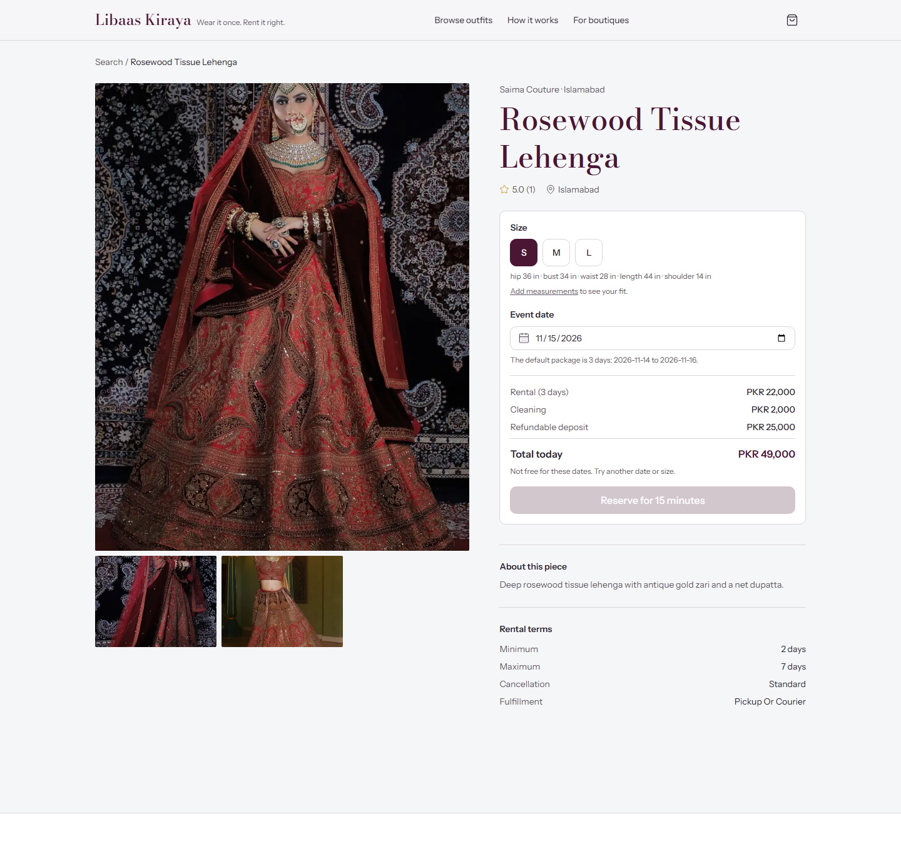

# Libaas Kiraya

Multi-vendor rental marketplace for occasion wear in Pakistan. Medusa v2 backend (2.22.0), Next.js 16 storefront, custom rental engine with database-enforced date availability.


| Search by date | Listing and fit |
|---|---|
|  |  |

Demo product photography sourced from Pexels under the [Pexels license](https://www.pexels.com/license/) ([photo credits](apps/storefront/public/images/seed/CREDITS.md)).

## What works today

- Customer and vendor auth actors (vendor is a custom actor type, not admin auth).
- Vendor onboarding, admin approval/rejection, vendor listing/unit/publish APIs.
- Seeded catalog with 6 vendors, 21 live listings, stock product photography, units and customers.
- Date-aware search, availability calendar endpoint, quote endpoint.
- 15-minute holds with a PostgreSQL exclusion constraint (`23P01` guards every overlap); verified 50-parallel reserve check yields exactly one winner.
- Cart integration with custom rental line price, removal, checkout, custom simulated-wallet payments, booking confirmation and secured deposit.
- Handover (with condition photos), return, inspection, customer accept/dispute, admin evidence compare, deposit release/refund, append-only ledger, payout batches.
- Customer booking list/detail, measurements and fit indicator; vendor portal (Today, Bookings, listing editor, Earnings); Medusa Admin pages for vendors, KYC docs, disputes with evidence, payouts and rental ops.
- SMTP email delivery through Mailpit locally, WhatsApp stub provider, seeded bookings in every lifecycle status, Playwright + axe smoke tests, Lighthouse assertions and deployment/backup notes.

Remaining work: real Stripe or local wallet merchant onboarding, hosted staging, retention automation for private evidence/KYC, production load testing and the demo video. See `docs/deployment.md`.

## Local stack

Requirements: Node.js 22.22+, pnpm 12+, Docker.

```bash
pnpm install
docker compose up -d
cp apps/backend/.env.template apps/backend/.env   # fill values
pnpm --filter backend db:setup
pnpm --filter backend seed
pnpm --filter backend dev
pnpm --filter storefront dev
```

- Medusa API and admin: http://localhost:9000 (admin at `/app`)
- Storefront: http://localhost:3000
- Mailpit: http://localhost:8025
- RustFS S3 API: http://localhost:9002, console http://localhost:9003 (credentials in `.env.example`)

`seed` prints the storefront publishable key. Put it in `apps/storefront/.env.local` as `NEXT_PUBLIC_MEDUSA_PUBLISHABLE_KEY`.

Demo admin: `admin@libaas.local` / `supersecret` (create it with `pnpm --filter backend exec medusa user -e admin@libaas.local -p supersecret`).

Vendor login is independent of admin auth: register at `/vendor/register`, then approve the boutique in Admin ? Vendors.

## Verification

```bash
pnpm --filter backend lint
pnpm --filter backend typecheck
pnpm --filter backend test:unit
pnpm --filter backend exec medusa exec ./src/scripts/concurrency-check.ts
pnpm --filter backend build
pnpm --filter storefront typecheck
pnpm --filter storefront build
pnpm e2e
pnpm lighthouse
```

The concurrency check reserves one single-unit listing 50 times in parallel and fails unless exactly one call succeeds; it then cleans up the winning hold. The database also rejects overlapping booking/block ranges directly (integration constraint test lives next to the rental module).

## Architecture notes

- Business logic lives in `apps/backend/src/modules` (data), `workflows` (orchestration with compensation) and `api` (HTTP only).
- Availability uses `rental_booking.blocked_during` (generated `daterange`) plus an exclusion constraint on `(unit_id, blocked_during)`; `rental_block` has the same guard. Cross-table booking-vs-block races are serialized by locking the unit row and re-checking before insert.
- Money is integer PKR in `bigNumber` fields; pricing/refund rules are pure functions in `apps/backend/src/lib/pricing.ts` with Jest and fast-check coverage.
- Ledger rows are append-only; balances are derived. Payouts mark included entries paid with a reference.
- The storefront uses the Medusa JS SDK and custom `/store/rentals/*`, `/store/carts/:id/rentals` and `/store/rental-carts/:id/complete` routes.

See `docs/adr/` for decisions and deviations.
